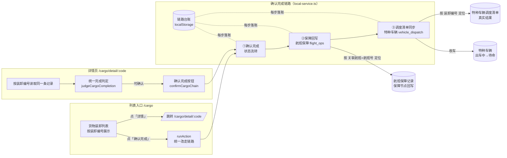
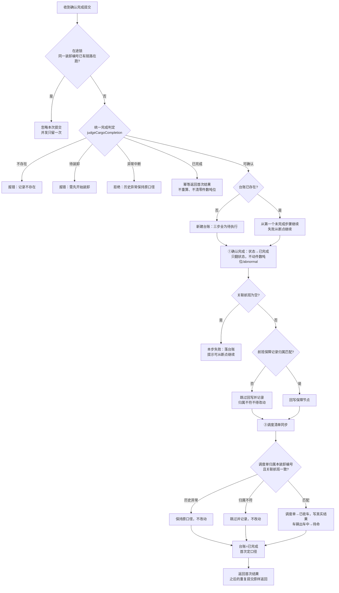

# 货物装卸确认完成链路：数据流、三步链路与共享根因

## 1. 装卸编号的数据流

`装卸编号` 是这条链路的唯一主键，从发起到回写全程不换键、不复制口径：

- **列表入口**（`views/cargo/index.vue`）：每行带「详情」链接与「确认完成」动作；`确认完成`
  在 `runAction` 里被统一改走链路，不再单独翻状态。
- **详情页**（`views/cargo/detail.vue`）：按路由里的 `装卸编号` 读同一条记录，展示统一完成判定、
  三步链路进度、保障回写目标与本编号的调度清单。
- **保障回写**：链路第②步按 `关联航班 = 航班号` 定位航班保障记录，回写
  `保障节点 = 货物装卸已完成(装卸编号)`；第③步按 `装卸编号` 定位调度单，把真实结果
  （已收车、实际收车时间、实际结果）写回特种车辆调度清单。

## 2. 三步链路流程图

## 3. 共享根因与修复对照

**共享根因**：完成判定和确认动作被各个入口各自实现了一遍——确认时重新推导并重写整条
记录，件数吨位在重写载荷里缺省被置零；同一批货物品类重复确认一次就重写一次，件数吨位
被清零；列表入口与详情页（以及车辆页）各读各的口径，两侧结果自然对不上。

| 症状 | 根因 | 修复 |
| --- | --- | --- |
| 重复确认后件数吨位被清零 | 确认动作重算并重写业务字段 | 确认只翻状态与完成时间，`件数吨位` 一律不写；重复确认走幂等返回 |
| 两侧结果对不上 | 完成判定散落在各入口 | `judgeCargoCompletion` 是唯一判定，`runAction`、详情页、链路内部共用 |
| 并发重复提交 | 没有幂等键 | 在途锁 + 台账：同一装卸编号只留一次，重复提交沿用首次结果 |
| 中途失败要重来 | 没有断点 | 台账逐步落账，重试从第一个未完成步骤继续 |
| 历史异常被改写 | 同步时无差别重写 | 异常中断装卸单、`异常`调度单一律跳过，`abnormal` 标志从不写 |
| 回写串到别人头上 | 不校验归属 | 关联航班 / 装卸编号 / 车辆编号不符的记录一律不改动，只记录跳过原因 |

## 4. 约束落地位置

- **并发提交只留一次**：`confirmCargoChain` 的在途锁（`cargoChainInFlight`）+ 台账幂等
  （`已完成` 直接返回首次结果）。
- **失败从断点继续**：台账存于 `localStorage`（`airport-ground-handling:cargo-chain-journal`），
  每步完成即落账；失败步骤标记「失败」，重新提交从该步继续，已成功步骤不重复执行。
- **历史异常记录保持原口径**：`异常中断` 装卸单判定即拒绝；`异常` 调度单跳过；
  链路全程不写 `abnormal` 字段。
- **归属不符不得改动**：回写前校验 `关联航班 = 航班号`、同步前校验 `装卸编号` 与
  `关联航班`、收车前校验 `车辆编号` 存在；不符则跳过并在台账里记录原因。
