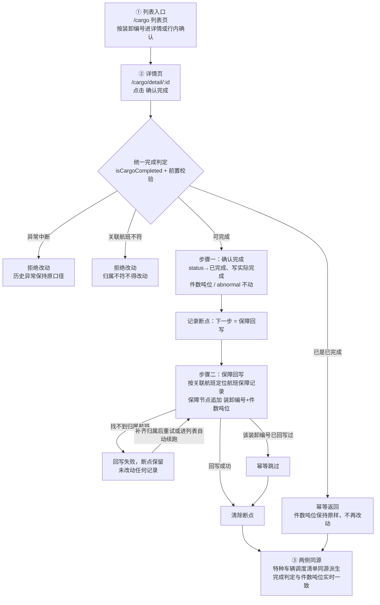

# 货物装卸三步链路：数据流、流程图与统一完成判定

## 1. 数据流：装卸编号如何穿过三步链路

装卸编号是全链路的唯一键，三步都靠它定位同一条记录：

| 步骤 | 位置 | 读 | 写 |
| --- | --- | --- | --- |
| ① 列表入口 | `views/cargo/index.vue` → `listEntries('cargo')` | localStorage 里的 cargo 记录（按装卸编号筛选、进入详情） | 行内「确认完成」也走统一链路，不再走通用动作 |
| ② 详情页 | `views/cargo/detail.vue`（`/cargo/detail/:id`） | `getCargoFlowView(id)`：记录本体 + 断点 + 链路进度 | `confirmCargoCompletion(id)`：状态→已完成、写实际完成；**件数吨位、货物品类、abnormal 等历史字段一律不动** |
| ③ 保障回写 | `api/cargo-flow.ts` 的 `writebackStep` | 按「关联航班 = 航班号」定位 flight_ops 记录 | 保障节点追加 `货物装卸已完成（装卸编号，件数吨位）`，同一装卸编号只回写一次 |

特种车辆页的「特种车辆调度清单」（`listCargoDispatch()`）不另存拷贝，直接同源读取货物装卸记录，
所以完成判定与件数吨位永远和货物装卸侧一致——这是"两侧结果对得上"的结构性保证。

## 2. 流程图

## 3. 共享根因

"同一批货物品类重复确认后件数吨位被清零、两侧结果对不上"是同一个根因的两个症状：

- **完成判定没有唯一出处**：列表动作、详情、回写各自判断"是否完成"，重复确认被当成一次新的完成去冲减件数吨位，直至清零；
- **两侧各存各的结果**：货物装卸侧与车辆/保障侧没有同源关系，一边被冲减、另一边还是旧值，自然对不上。

修复方式不是"两边对账"，而是**统一判定 + 同源派生**：

- `isCargoCompleted(row)` 是唯一完成判定，所有页面与回写共用；
- `confirmCargoCompletion(id)` 是唯一确认入口，幂等——重复确认直接返回已有结果，件数吨位只读不写；
- 特种车辆调度清单从货物装卸记录实时派生，没有第二份拷贝可以发散。

## 4. 规则落实

| 要求 | 实现 |
| --- | --- |
| 统一完成判定 | `isCargoCompleted()` 唯一口径；确认链路只写 `status/实际完成/装卸状态`，件数吨位等历史字段不动 |
| 并发提交只留一次 | `confirmCargoCompletion` 按装卸编号持有在途 Promise，并发调用复用同一结果；列表与详情按钮提交中禁用 |
| 失败从断点继续 | 确认完成 → 保障回写每步落断点（localStorage `airport-ground-handling:cargo-flow`）；失败保留断点，详情页可手动「从断点继续」，回到列表页也会自动 `resumePendingFlows()` 续跑 |
| 历史异常记录保持原口径 | `异常中断` 记录不参与完成判定、确认链路拒绝改动；`abnormal` 标记与历史字段一律不回写、不"修复" |
| 归属不符不得改动 | 确认时校验调用方看到的关联航班与当前记录一致；回写时找不到归属航班即失败且不改动任何记录，断点保留待归属补齐后续跑 |
| 特种车辆调度清单同步真实结果 | `listCargoDispatch()` 同源派生：完成判定、件数吨位、完成时间直接读货物装卸记录，异常状态按原口径展示 |

## 5. 涉及文件

- `frontend/src/api/cargo-flow.ts`：统一完成判定、幂等确认、并发守卫、断点续跑、保障回写、调度清单派生
- `frontend/src/views/cargo/index.vue`：列表入口，行内「确认完成」接入统一链路，挂载时自动续跑断点
- `frontend/src/views/cargo/detail.vue`：详情页，链路进度、确认完成、断点续跑
- `frontend/src/views/special_vehicle/index.vue`：特种车辆调度清单（同源真实结果）
- `frontend/src/data/seed.ts`：示例数据里 cargo.关联航班 与 flight_ops.航班号 对齐（CA3101/3102/3103），前两条为同一批货物品类
